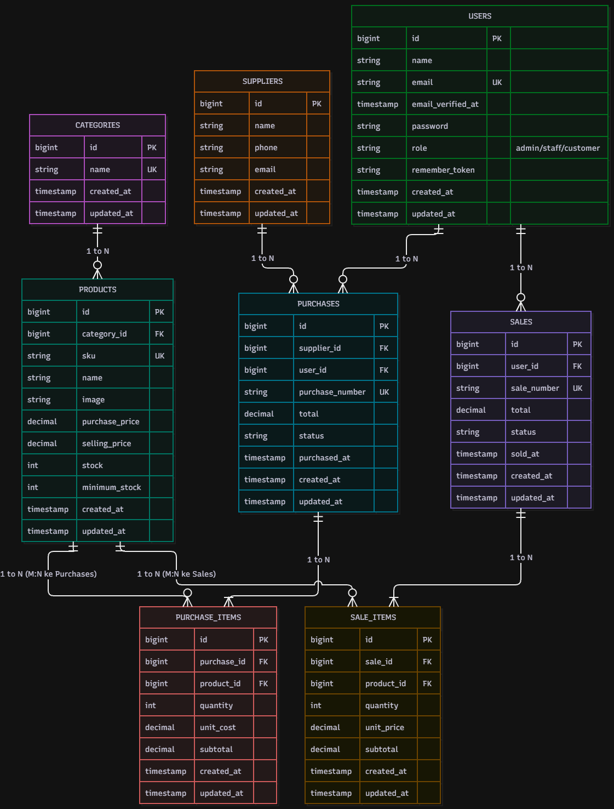

# Entity Relationship Diagram (ERD) - UTS Inventory Laravel

Dokumen ini berisi pemodelan basis data (ERD), relasi antartabel, dan kamus data yang diekstraksi langsung dari migrasi dan model project `UTS_Inventory_Laravel`.

---

## 1. Diagram ERD

---

## 2. Hubungan Antar Entitas (Cardinality & Foreign Keys)

| Entitas Asal | Hubungan | Entitas Tujuan | Foreign Key | Penjelasan Relasi |
| :--- | :---: | :--- | :--- | :--- |
| **`categories`** | `1 : N` | **`products`** | `products.category_id` | Satu kategori menaungi banyak produk (`restrictOnDelete`). |
| **`suppliers`** | `1 : N` | **`purchases`** | `purchases.supplier_id` | Satu supplier dapat memasok banyak transaksi pembelian/restock (`restrictOnDelete`). |
| **`users`** | `1 : N` | **`purchases`** | `purchases.user_id` | Satu user (admin/staff) mencatat banyak transaksi restock (`restrictOnDelete`). |
| **`purchases`** | `1 : N` | **`purchase_items`** | `purchase_items.purchase_id` | Satu transaksi restock memiliki banyak item rincian (`cascadeOnDelete`). |
| **`products`** | `1 : N` | **`purchase_items`** | `purchase_items.product_id` | Satu produk dapat muncul di berbagai rincian restock (`restrictOnDelete`). |
| **`users`** | `1 : N` | **`sales`** | `sales.user_id` | Satu user (pelanggan/customer) dapat melakukan banyak transaksi pesanan (`restrictOnDelete`). |
| **`sales`** | `1 : N` | **`sale_items`** | `sale_items.sale_id` | Satu nota transaksi penjualan terdiri dari rincian barang belanjaan (`cascadeOnDelete`). |
| **`products`** | `1 : N` | **`sale_items`** | `sale_items.product_id` | Satu produk dapat dibeli dalam banyak transaksi penjualan (`restrictOnDelete`). |

---

## 3. Kamus Data (Data Dictionary) Singkat

1. **`users`**: Akun pengguna sistem dengan multi-role (`admin`, `staff`, `customer`).
2. **`categories`**: Data master kelompok produk barang (contoh: Blind Box, Action Figure, Plushie, dll.).
3. **`suppliers`**: Data master kontak pemasok barang ke toko.
4. **`products`**: Data inventori produk yang mencakup SKU, harga beli (`purchase_price`), harga jual (`selling_price`), jumlah stok fisik, dan batas minimum stok peringatan.
5. **`purchases`**: Header transaksi pengadaan/restock produk dari pihak supplier.
6. **`purchase_items`**: Detail item produk yang dibeli saat restock beserta kuantitas dan harga belinya.
7. **`sales`**: Header nota transaksi pembelian produk oleh customer.
8. **`sale_items`**: Detail item produk yang dibeli customer pada nomor nota transaksi tersebut.
