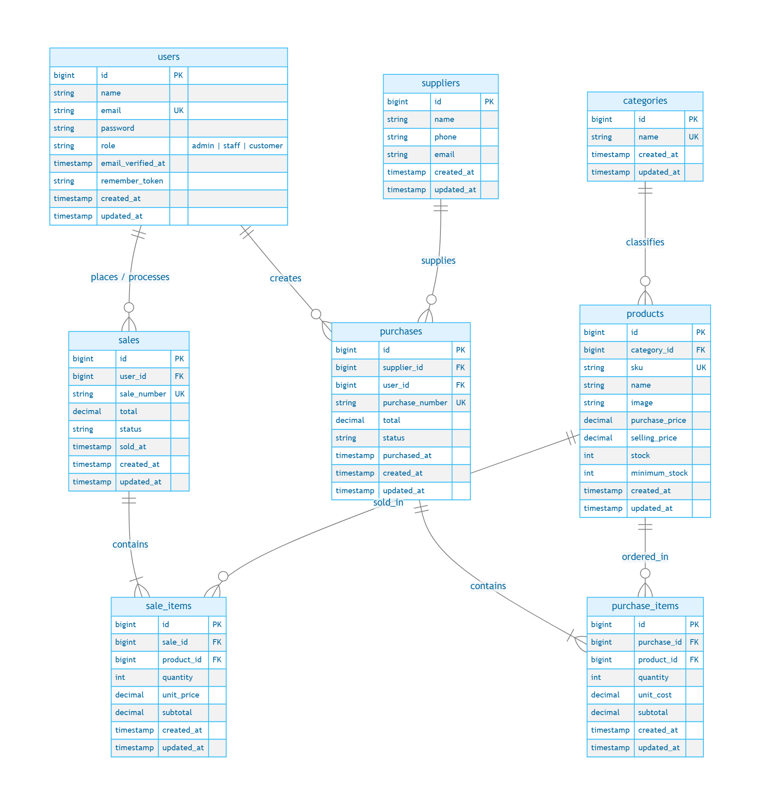

#  Pop Mart & Art Toys Inventory & Sales Management System

[](https://laravel.com)
[](https://www.php.net/)
[](https://www.mysql.com/)
[](https://tailwindcss.com/)
[](LICENSE)

Aplikasi web inventaris dan kasir modern berbasis **Laravel** yang dirancang untuk mengelola rantai pasok dan penjualan toko mainan/koleksi seni (*Art Toys & Pop Mart Designer Figures*). Sistem ini menyediakan kontrol stok otomatis, pemisahan hak akses multi-role (Admin, Staff, Customer), transaksi pembelian pemasok (*purchase*), pencatatan penjualan (*point of sale* & *customer self-checkout*), serta cetak nota struk transaksi.

---

##  Daftar Isi
- [Latar Belakang & Fitur Utama](#-fitur-utama)
- [Hak Akses Pengguna (Role Matrix)](#-hak-akses-pengguna-role-matrix)
- [Diagram Relasi Entitas (ERD) & Basis Data](#️-diagram-relasi-entitas-erd--basis-data)
- [Struktur Direktori Proyek](#-struktur-direktori-proyek)
- [Persyaratan Sistem](#-persyaratan-sistem)
- [Panduan Instalasi & Menjalankan](#-panduan-instalasi--menjalankan)
- [Akun Demo Pengujian](#-akun-demo-pengujian)
- [Keamanan & Integritas Data](#-keamanan--integritas-data)
- [Kontribusi & Lisensi](#-lisensi)

---

##  Fitur Utama

### 1.Interactive Dashboard & KPI Metrics
- **Metrik Real-time**: Total omzet penjualan, jumlah pesanan, total varian katalog, dan total mitra supplier.
- **Alert Stok Menipis (Low Stock Alert)**: Notifikasi dini ketika stok produk mencapai atau berada di bawah ambang batas minimum (`stock <= minimum_stock`).
- **Analitik Kategori Populer**: Peringkat kategori terlaris (*Blind Box*, *Action Figure*, *Plushie*, *Accessories*) yang dikalkulasi secara dinamis dari transaksi aktif.
- **Tampilan Khusus Customer**: Riwayat pesanan pribadi, status transaksi, serta akumulasi total belanjaan langsung dari dashboard.

### 2.Manajemen Master Data & Katalog (Admin Only)
- **Katalog Produk Terpadu**: Manajemen SKU unik, nama barang, gambar pratinjau, harga beli (*purchase price*), harga jual (*selling price*), stok terkini, dan batas *minimum stock*.
- **Kategori & Supplier**: CRUD kategori dan direktori pemasok lengkap dengan validasi integritas *foreign key* (mencegah penghapusan kategori/supplier yang masih memiliki relasi data).
- **Pencarian Cepat**: Filter katalog produk berdasarkan nama, kode SKU, maupun kategori.

### 3.Restock & Pembelian Pemasok (*Purchases*)
- Pengadaan barang masuk dari supplier dengan penomoran dokumen otomatis.
- Pencatatan harga modal satuan dan total biaya transaksi.
- Otomasi penambahan kuantitas stok produk seketika transaksi pembelian berhasil disimpan.

### 4.Sistem Kasir & Self Checkout (*Sales*)
- **Staff / Admin POS**: Kasir dapat memproses transaksi penjualan langsung di toko fisik dengan pemotongan stok otomatis.
- **Customer Self Checkout**: Pelanggan dapat memilih produk melalui etalase, menentukan jumlah unit, dan melakukan pemesanan langsung dari portal akun mereka dengan metode pembayaran Tunai (Cash).
- **Safety Lock & Race-Condition Safe**: Menggunakan `DB::transaction` dan `lockForUpdate()` untuk mencegah *overselling* (pembelian melebihi sisa stok riil).

### 5.Filter & Pencarian Cepat Multi-Level
- Dilengkapi kolom input pencarian interaktif berikon kaca pembesar (*search icon*) di katalog belanja customer, riwayat pesanan, tabel transaksi kasir, maupun tabel inventaris produk admin & staff.
- Filter cepat berdasarkan kategori produk, status stok (Aman / Kritis / Habis), serta rentang tanggal transaksi.

### 6.Cetak Nota Transaksi (*Invoice Generator*)
- Halaman struk/nota digital dengan format bersih, siap cetak (*print-ready*).
- Perlindungan privasi: Pelanggan hanya dapat melihat faktur/nota miliknya sendiri (`403 Forbidden` jika mengakses invoice pengguna lain).

---

## Hak Akses Pengguna (Role Matrix)

Sistem menerapkan pengamanan berbasis peran (*Role-Based Access Control*) melalui middleware:

| Modul / Fitur | Administrator | Staff (Kasir) | Customer (Pelanggan) |
| :--- | :---: | :---: | :---: |
| **Login & Dashboard Ringkasan** | ✅ (Full KPI) | ✅ (Full KPI) | ✅ (Statistik Pribadi) |
| **Katalog Produk (Lihat & Cari)** | ✅ | ✅ | ✅ (Halaman Depan) |
| **Kelola Produk (Tambah/Edit/Hapus)** | ✅ | ❌ | ❌ |
| **Kelola Kategori & Supplier** | ✅ | ❌ | ❌ |
| **Pengadaan Stok (Purchases)** | ✅ | ❌ | ❌ |
| **Kasir Penjualan Toko (Sales POS)** | ✅ | ✅ | ❌ |
| **Belanja Mandiri (Customer Checkout)**| ❌ | ❌ | ✅ |
| **Lihat & Cetak Nota Struk** | ✅ (Semua) | ✅ (Semua) | ✅ (Hanya Milik Sendiri) |

---

## Diagram Relasi Entitas (ERD) & Basis Data

Aplikasi menggunakan basis data relasional MySQL dengan integritas relasi yang ketat dan menerapkan kaidah normalisasi database:

### 1. Entity Relationship Diagram (ERD)



#### Struktur & Skema Entitas Relasional

| Nama Entitas | Kolom Kunci & Tipe | Relasi (Foreign Key) | Keterangan |
| :--- | :--- | :--- | :--- |
| **`users`** | `id` (PK, BigInt), `email` (UK) | - | Menyimpan akun pengguna (Admin, Staff, Customer). |
| **`categories`** | `id` (PK, BigInt), `name` (UK) | - | Klasifikasi kategori katalog mainan/koleksi seni. |
| **`suppliers`** | `id` (PK, BigInt) | - | Rekanan pemasok/vendor untuk restock inventaris. |
| **`products`** | `id` (PK, BigInt), `sku` (UK) | `category_id` ➔ `categories(id)` | Katalog master item, harga beli/jual, dan batas stok fisik. |
| **`purchases`** | `id` (PK, BigInt), `purchase_number` (UK) | `supplier_id` ➔ `suppliers(id)`<br>`user_id` ➔ `users(id)` | Faktur transaksi masuk (restock dari pemasok). |
| **`purchase_items`** | `id` (PK, BigInt) | `purchase_id` ➔ `purchases(id)`<br>`product_id` ➔ `products(id)` | Rincian kuantitas & harga modal item pengadaan masuk. |
| **`sales`** | `id` (PK, BigInt), `sale_number` (UK) | `user_id` ➔ `users(id)` | Faktur transaksi keluar (kasir POS atau customer checkout). |
| **`sale_items`** | `id` (PK, BigInt) | `sale_id` ➔ `sales(id)`<br>`product_id` ➔ `products(id)` | Rincian kuantitas & harga jual item transaksi keluar. |

### 2. Penjelasan Relasi Antar Entitas

| Hubungan Relasi | Kardinalitas | Aturan Hapus (On Delete) | Deskripsi Fungsional |
| :--- | :---: | :---: | :--- |
| **`categories` ➔ `products`** | 1 : N | `RESTRICT` | Setiap produk harus memiliki satu kategori. Kategori tidak dapat dihapus jika masih menampung produk. |
| **`suppliers` ➔ `purchases`** | 1 : N | `RESTRICT` | Setiap transaksi restock mencatat mitra pemasok penyedia barang. Pemasok terlindungi dari penghapusan jika memiliki rekam faktur. |
| **`users` ➔ `purchases`** | 1 : N | `RESTRICT` | Mencatat petugas/admin operator yang melakukan transaksi pengadaan barang masuk. |
| **`purchases` ➔ `purchase_items`**| 1 : N | `CASCADE` | Satu faktur pembelian menampung rincian beberapa item barang. Jika faktur dihapus, rincian item ikut terhapus. |
| **`products` ➔ `purchase_items`** | 1 : N | `RESTRICT` | Menghubungkan produk ke baris faktur pembelian untuk riwayat harga modal perolehan. |
| **`users` ➔ `sales`** | 1 : N | `RESTRICT` | Mencatat kasir yang bertugas (untuk transaksi POS) atau customer pemesan (untuk self-checkout). |
| **`sales` ➔ `sale_items`** | 1 : N | `CASCADE` | Satu nota penjualan menampung rincian barang yang dibeli beserta subtotalnya. |
| **`products` ➔ `sale_items`** | 1 : N | `RESTRICT` | Menghubungkan produk ke bukti pembelian riil, menjamin audit trail histori harga jual tidak hilang. |

### 3. Kamus Data Singkat

- **`users`**: Tabel pengguna dengan pembedaan level akses melalui atribut `role` (`admin`, `staff`, `customer`).
- **`categories`**: Klasifikasi jenis mainan koleksi (*Blind Box*, *Action Figure*, *Mega Collection*, *Plushie*).
- **`suppliers`**: Buku kontak rekanan vendor, distributor, dan produsen resmi art toys.
- **`products`**: Master barang toko yang dilengkapi kode unik `sku`, harga modal `purchase_price`, harga eceran `selling_price`, stok fisik `stock`, dan ambang batas `minimum_stock`.
- **`purchases` & `purchase_items`**: Transaksi masuk (*Restock*) dari pihak pemasok yang otomatis menambah kuantitas `stock` barang.
- **`sales` & `sale_items`**: Transaksi keluar (*Kasir & Belanja Pelanggan*) dengan nomor faktur unik (`SALE-YYYYMMDD-XXXX` atau `ORDER-YYYYMMDD-XXXX`) yang otomatis memotong stok secara atomik.

---

## Struktur Direktori Proyek

```plaintext
uts-inventory/
├── app/
│   ├── Http/
│   │   ├── Controllers/
│   │   │   ├── AuthController.php      # Autentikasi & sesi pengguna
│   │   │   ├── ProductController.php   # Manajemen inventaris produk
│   │   │   ├── PurchaseController.php  # Transaksi barang masuk dari supplier
│   │   │   ├── SaleController.php      # Transaksi penjualan kasir (POS)
│   │   │   └── SupplierController.php  # Manajemen kontak pemasok
│   │   └── Middleware/
│   │       └── RoleMiddleware.php      # Proteksi rute berdasarkan peran pengguna
│   └── Models/                         # Eloquent Models (Product, Category, Sale, dll.)
├── database/
│   ├── migrations/                     # Skema tabel sistem
│   └── seeders/
│       └── DatabaseSeeder.php          # Seeder akun demo & kategori default
├── resources/
│   └── views/
│       ├── categories/                 # Antarmuka kategori produk
│       ├── invoices/                   # Tampilan cetak nota struk
│       ├── layouts/                    # Layout induk (Navbar, Sidebar Pop Mart style)
│       ├── products/                   # Form katalog, tambah, & ubah produk
│       ├── purchases/                  # Form pengadaan barang & riwayat restock
│       ├── sales/                      # Kasir kasir / kasir toko & daftar order
│       ├── checkout.blade.php          # Tampilan proses order mandiri customer
│       ├── dashboard.blade.php         # Tampilan beranda analitik
│       └── login.blade.php             # Form login bernuansa pastel
└── routes/
    └── web.php                         # Definisi rute aplikasi & grouping middleware
```

---

## Persyaratan Sistem

Pastikan *environment* lokal Anda memenuhi kualifikasi berikut:
- **PHP**: `^8.0` atau `^8.1` (dengan ekstensi `pdo_mysql`, `mbstring`, `openssl`, `tokenizer`, `xml`, `ctype`, `json`)
- **Composer**: Versi `2.x`
- **Database Engine**: MySQL `5.7+` / `8.0+` atau MariaDB `10.4+`
- **Web Browser**: Google Chrome, Mozilla Firefox, Microsoft Edge, atau Safari versi terkini

---

## Panduan Instalasi & Menjalankan

Ikuti langkah-langkah berikut untuk menjalankan proyek di komputer lokal:

### 1. Salin Repositori & Buka Direktori
```bash
git clone <URL_REPOSITORY_ANDA>
cd uts-inventory
```

### 2. Instal Dependensi Composer
```bash
composer install
```

### 3. Konfigurasi File Lingkungan (.env)
Salin contoh berkas environment dan buat salinan baru bernama `.env`:
```bash
cp .env.example .env
```
Buka file `.env` dan sesuaikan koneksi database MySQL Anda:
```env
DB_CONNECTION=mysql
DB_HOST=127.0.0.1
DB_PORT=3306
DB_DATABASE=uts_inventory
DB_USERNAME=root
DB_PASSWORD=
```

### 4. Buat Application Key
```bash
php artisan key:generate
```

### 5. Jalankan Migrasi & Seeder Data Awal
Pastikan database dengan nama yang ditentukan (misal `uts_inventory`) sudah dibuat di DBMS Anda (phpMyAdmin / DBeaver / Navicat / MySQL CLI). Kemudian jalankan:
```bash
php artisan migrate --seed
```

### 6. Hubungkan Berkas Media / Storage (Jika menggunakan upload gambar)
```bash
php artisan storage:link
```

### 7. Jalankan Server Pengembangan Lokal
```bash
php artisan serve
```
Buka browser dan akses aplikasi melalui tautan:
**[http://localhost:8000](http://localhost:8000)**

---

## Akun Demo Pengujian

Setelah menjalankan `php artisan migrate --seed`, akun demo berikut otomatis tersedia untuk pengujian:

| Role | Email Login | Kata Sandi | Deskripsi Akses |
| :--- | :--- | :--- | :--- |
| **Admin** | `admin@toko.com` | `password` | Akses penuh seluruh master data, pembelian supplier, katalog produk, dan laporan |
| **Staff** | `staff@toko.com` | `password` | Akses operasional kasir penjualan (POS), katalog stok, serta cetak nota transaksi |
| **Customer** | `customer@toko.com` | `password` | Akses belanja mandiri (checkout etalase), melihat status belanjaan & faktur pribadi |

---

## 🛡️ Keamanan & Integritas Data

- **Database Transaction (`DB::transaction`)**: Seluruh proses transaksi yang melibatkan pemotongan atau penambahan stok dibungkus dalam transaksi database untuk menjamin prinsip ACID (tidak ada selisih stok jika terjadi kegagalan sistem di tengah jalan).
- **Pencegahan Concurrency Issue (`lockForUpdate`)**: Mengunci baris produk saat proses checkout berlangsung sehingga aman dari duplikasi atau pembelian ganda pada stok terakhir.
- **CSRF Protection**: Seluruh formulir POST/PUT/DELETE dilengkapi token `@csrf` untuk mencegah serangan *Cross-Site Request Forgery*.
- **Role Middleware**: Validasi otorisasi server-side di setiap rute sensitif, mencegah manipulasi URL langsung oleh pengguna tanpa izin.
- **Foreign Key Constraints**: Menggunakan aturan `restrictOnDelete` pada data vital (seperti kategori atau produk yang pernah bertransaksi) guna menjaga konsistensi riwayat pembukuan.

---

## Lisensi

Proyek ini dibuat untuk keperluan akademik dan didistribusikan di bawah lisensi [MIT](LICENSE). Silakan gunakan dan sesuaikan sesuai kebutuhan pengembangan.
